# AGENT_FLOWS.md — I flussi agentici di p-secretary

**Data**: 2026-10-18 · **Complementa**: `AGENTS.md` (baseline), `SECRETARY_ARCHITECTURE_PLAN.md` (visione), `OWNER_DIALOGUE.md` (dialogo)

> Come lavora l'agente: ogni flusso con **input**, **output**, **guardie** e **invarianti**.
> Il principio cardine vale per tutto: **il modello non è mai autorità — la provenance nativa lo è.**

## Indice

1. Panoramica: worker e cicli
2. Ingestione e routing dei messaggi
3. Worker analysis
4. Dialogo owner — il loop agentico principale
5. Autorizzazione di un'azione
6. Il piano del segretario: prepare → apply
7. Revisioni runtime (bounded review)
7-bis. Worker research — lavoro lungo con sub-job
7-ter. Istruzioni permanenti dell'owner — il capo insegna comportamenti nuovi
8. Gateway email — i tre gesti dell'owner
9. La macchina a stati delle ricevute
10. Riconciliazione task
11. Digest giornaliero
12. Guardie trasversali: budget AI, quiet hours, modalità
13. Esempio end-to-end

---

## 1. Panoramica: worker e cicli

L'agente non è un loop monolitico: è un insieme di **worker indipendenti** che consumano una **coda durevole** PostgreSQL (`work_jobs`). Ogni worker ha una responsabilità stretta; nessuno può agire fuori dal proprio confine di policy.

```mermaid
flowchart TB
    subgraph CANALI["Canali nativi in ingresso"]
        E["Email IMAP"]
        T["Telegram bot"]
        W["WhatsApp bridge"]
        TA["Telethon (solo archivio)"]
    end

    MS["message_store<br/>tabelle native per canale<br/>+ vista communications"]
    Q[("work_jobs<br/>coda durevole<br/>SKIP LOCKED · lease 15 min")]

    subgraph WK["Worker (main.py)"]
        AW["analysis"]
        MW["media"]
        RW["reconcile"]
        AC["action"]
        OW["owner"]
        KW["knowledge"]
        SR["secretary_review"]
        RS["research"]
        EE["secretary_email_execution"]
    end

    B["brain + ai_budget<br/>ledger fail-closed"]
    SEC["secretary<br/>piani v2 · prepare → apply"]
    RT["secretary_runtime<br/>revisioni limitate"]
    OD["owner_dialogue<br/>lease 12 min"]
    POL["policy<br/>consensi + ricevute"]
    KN["knowledge<br/>catalogo v2"]

    subgraph EFF["Effetti in uscita"]
        NT["Notifiche owner<br/>(quiet hours)"]
        GC["Calendar<br/>(grant sigillati v3)"]
        ML["Email<br/>(gateway 3 gesti)"]
        PR["Proposte / approvazioni"]
    end

    CANALI --> MS --> Q --> WK
    AW --> B
    KW --> KN
    OW --> OD --> SEC
    SR --> RT --> SEC
    RS --> KN
    SEC --> POL
    AC --> POL
    EE --> ML
    POL --> EFF
    POL -.->|consensi ai_text / ai_media / ai_history| B
```

**I 9 worker e i loro confini:**

| Worker | Consuma | Input | Output principale |
|---|---|---|---|
| `analysis` | job `analysis` | message_id | verdetto JSON, job task/appuntamento/fattura, notifiche, osservazioni runtime |
| `media` | job `media` | allegato | trascrizioni audio / descrizioni immagini (consenso `ai_media`) |
| `reconcile` | job `reconcile` | ingresso live | cambi task auto-applicati o proposte all'owner |
| `action` | job `action` | payload azione | effetti esterni con ricevute (notify, calendar, invoice, reminder, zip) |
| `owner` | job `owner` | messaggio owner nativo diretto | risposta + piani applicati + task + memoria |
| `knowledge` | job `knowledge` | message_id | estrazioni indicizzate nel catalogo (sha256, revisioni) |
| `secretary_review` | wakeup | revisione dovuta / osservazione | pratiche aggiornate (CAS) + notifiche coalesced |
| `research` | job `research` (decompose/subtask/synthesize) | domanda dell'owner | findings con citazioni + report persistito (nessun effetto esterno) |
| `secretary_email_execution` | job `execute_approved` | dispatch approvato | invio SMTP con ricevta attempt-before-I/O |

**Lanciatori periodici** (un thread vivo ciascuno): fetch email, digest, schedule (revisioni dovute, promemoria), secretary_reviews, whatsapp.

**Invarianti della coda** (`jobs.py`): claim con `SKIP LOCKED`; lease 15 min con heartbeat 30 s; deadline 1 h; backoff 15 s → 1 h; max 8 tentativi; `Deferred` non consuma tentativi; `assert_current` ricontrolla il lease **prima di ogni effetto**.

---

## 2. Ingestione e routing dei messaggi

Ogni canale porta identità native verificate: **UIDVALIDITY** per email, **metadata di forward** per Telegram, **version-ACK** per WhatsApp. Lo storico importato (Telethon, import email) è flaggato `historical` e resta contesto di sola lettura.

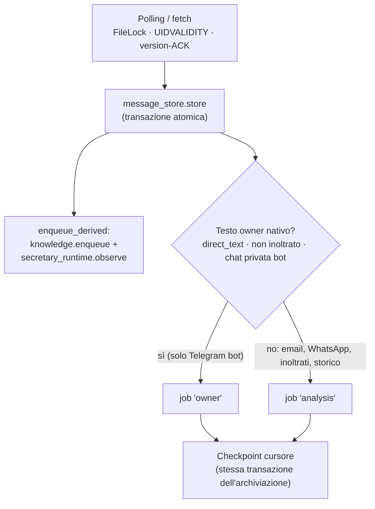

| | |
|---|---|
| **Input** | Messaggi nativi dai 4 canali (live o storico) |
| **Output** | Righe tabelle native; job `owner`/`analysis`; enqueue derivato (catalogo + osservazioni); checkpoint cursore |
| **Guardie** | Identità native verificate in ingresso; flag `historical`; dedup per canale |
| **Invarianti** | Store + enqueue atomici; cursore checkpointato **solo dopo** l'archiviazione, nella stessa transazione; contenuto indiretto/inoltrato dell'owner = solo evidenza, mai comando |

---

## 3. Worker analysis

Il primo sguardo dell'agente su ogni messaggio. Il modello produce un **verdetto JSON** (con `severity` e `urgent`), mai testo libero eseguibile.

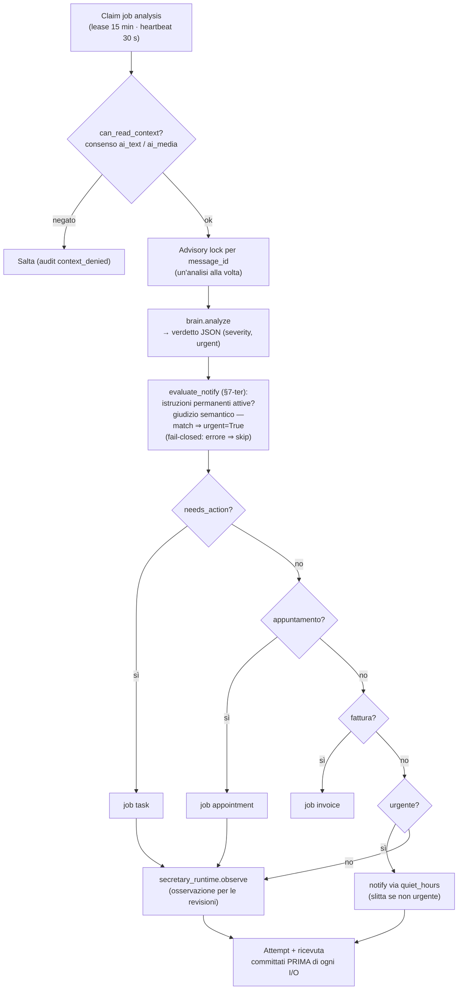

| | |
|---|---|
| **Input** | Job `analysis` con message_id |
| **Output** | Verdetto persistito; job task/appuntamento/fattura; notifiche (incl. urgent da istruzioni permanenti); osservazioni runtime |
| **Guardie** | `can_read_context` (default-deny); advisory lock per mid; budget AI; `evaluate_notify` fail-closed (un errore non rompe mai l'analisi) |
| **Invarianti** | Contenuto **indiretto** dell'owner non genera mai `needs_action`/appuntamenti; il contenuto del messaggio è untrusted data per il valutatore di istruzioni (non può crearle/modificarle); ogni I/O preceduto da attempt committato |

---

## 4. Dialogo owner — il loop agentico principale

Il cuore agentico: quando l'owner scrive direttamente al bot, `owner_dialogue.respond` orchestra inferenza, piano, effetti e risposta in un'unica transazione logica con lease e replay idempotente. Il retrieval è guidato da un **registry di tool read-only** (`agent_tools.py`): il modello può solo *nominare* un tool dichiarato e fornire argomenti tipati; il server valida, ricontrolla lease e consensi **per chiamata**, e filtra i risultati dentro il tool stesso. Il planner ha **round configurabili** (`RETRIEVAL_MAX_ROUNDS`, default 4, ceiling 8) e uno **scratchpad bounded** (note ≤200 char, max 8, inert data).

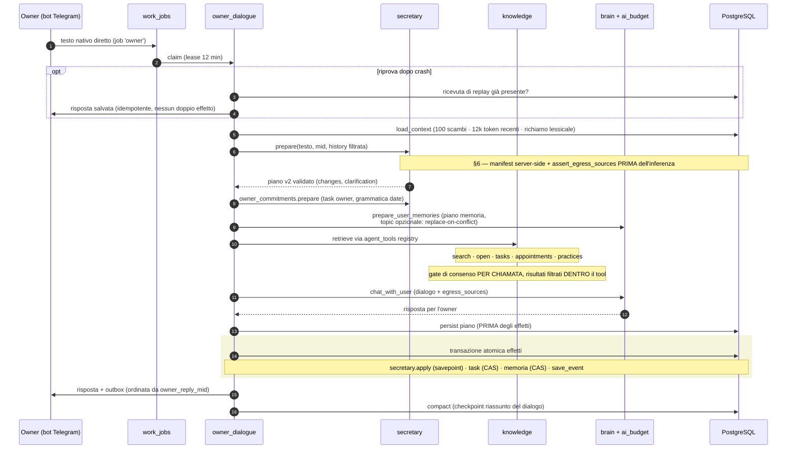

| | |
|---|---|
| **Input** | Messaggio owner nativo, diretto, non inoltrato, chat privata (job `owner`) |
| **Output** | Risposta + chunks in outbox; pratiche/responsabilità applicate; task owner; memoria; eventi calendario locali; ricevute |
| **Guardie** | Lease 12 min; identità owner stretta (`policy._owner`); consensi egress ricontrollati a ogni confine; budget AI; tool registry read-only con gate per chiamata (`open` limitato agli ID emersi dal server) |
| **Invarianti** | Piano **persistito prima** degli effetti; effetti in transazione atomica con savepoint e CAS; replay idempotente sulle riprove; la history è filtrata — i comandi storici non diventano mai istruzioni operative; nessun tool di scrittura/invio esiste nel registry |

---

## 5. Autorizzazione di un'azione

Come qualsiasi effetto — dal piano del segretario, dal worker action o dal dialogo — attraversa i cancelli prima di toccare il mondo esterno.

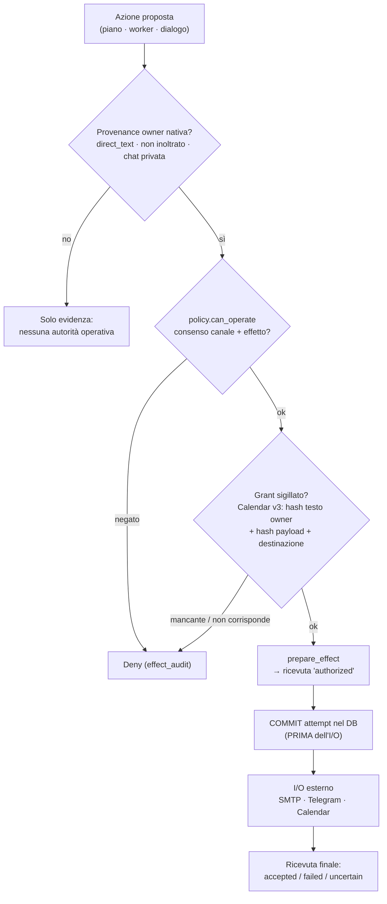

| | |
|---|---|
| **Input** | Azione con provenance (message_id) + payload |
| **Output** | Ricevute `authorized → attempted → accepted/failed/uncertain` |
| **Guardie** | Identità owner; consenso per canale+effetto; grant sigillati per Calendar; lease del job (`assert_current`) |
| **Invarianti** | La revoca di un consenso è ricontrollata a **ogni confine reale** (prepare, retrieval, provider finale) anche su manifest già materializzati; il replay di un grant non lo rinnova mai; "accepted ≠ delivered" |

---

## 6. Il piano del segretario: prepare → apply

Il modello **propone**, il server **valida e dispone**. Il manifest delle sorgenti non arriva mai dal modello: è risolto server-side e verificato prima dell'inferenza.

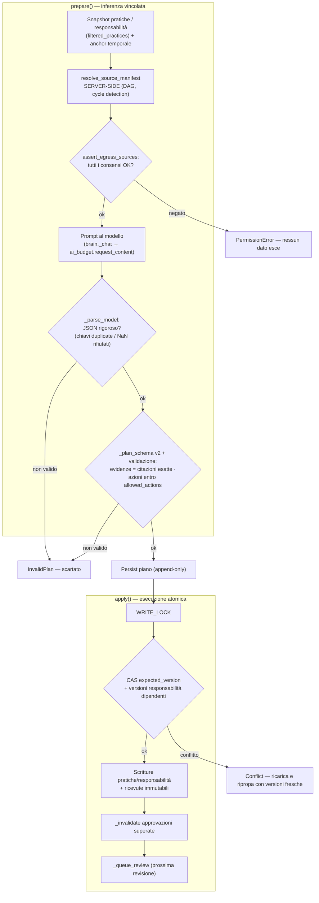

| | |
|---|---|
| **Input** | Testo owner + history filtrata + snapshot pratiche/responsabilità |
| **Output** | Piano v2 persistito (con `input_sources`/`input_versions`); ricevute di apply; revisione in coda |
| **Guardie** | Manifest server-side; `assert_egress_sources` prima dell'inferenza; parsing JSON rigoroso; schema del piano; CAS in apply |
| **Invarianti** | Il modello non può fornire il manifest né auto-concedersi consensi; ogni evidenza deve essere una citazione esatta di una sorgente reale; le azioni stanno dentro `allowed_actions`; apply atomico sotto lock |

---

## 7. Revisioni runtime (bounded review)

L'agente **segue** le pratiche nel tempo, ma in modo limitato: finestre di revisione obbligate, fonti riaperte e ricontrollate, stop condition solo strutturali.

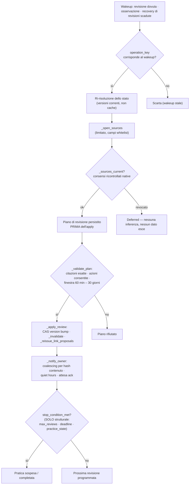

| | |
|---|---|
| **Input** | Wakeup (revisione dovuta, osservazione da messaggio live, recovery) |
| **Output** | Pratica aggiornata (CAS); notifica owner coalesced; link proposals riemesse; valutazione stop |
| **Guardie** | Finestra 60 min – 30 gg; citazioni esatte; consensi ricontrollati su ogni sorgente (anche vecchie versioni applicate); quiet hours |
| **Invarianti** | Piano persistito prima dell'apply; la **prosa** del modello non si esegue mai — solo stop condition strutturali; notifiche coalesced per hash per non tempestare l'owner |

---

## 7-bis. Worker research — lavoro lungo con sub-job

Il lease del dialogo (12 min) non può ospitare lavoro lungo. Il worker `research` (`research.py`) lo sposta su sub-job durevoli, ciascuno con lease proprio, e sintetizza i risultati. Tutto read-only verso il mondo esterno.

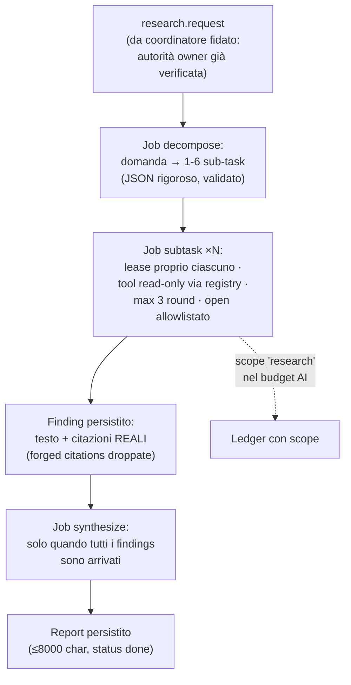

| | |
|---|---|
| **Input** | Domanda dell'owner + origin_message (autorità già verificata dal chiamante) |
| **Output** | Findings con citazioni reali; report finale persistito; nessun effetto esterno |
| **Guardie** | Decomposizione validata (1-6 sub-task, JSON rigoroso); tool solo dal registry read-only; `open` limitato agli ID emersi; citazioni forged droppate; budget scope 'research' |
| **Invarianti** | Ogni sub-job ha lease proprio e ricontrolla lo stato della request; la sintesi parte solo a findings completi; il testo del modello è DATA mai autorità; il report non viene mai inviato — il chiamante lo legge come contesto non fidato |

---

## 7-ter. Istruzioni permanenti dell'owner — il capo insegna comportamenti nuovi

Quando l'owner dice "da ora in poi…", il segretario impara una procedura stabile. Il design separa **condizione** e **azione**: la condizione è il linguaggio libero dell'owner, giudicato **semanticamente dal modello** a ogni messaggio in arrivo; l'azione è un vocabolario chiuso agganciato ai gateway di effetto esistenti. Il modello giudica QUANDO; il server decide COSA.

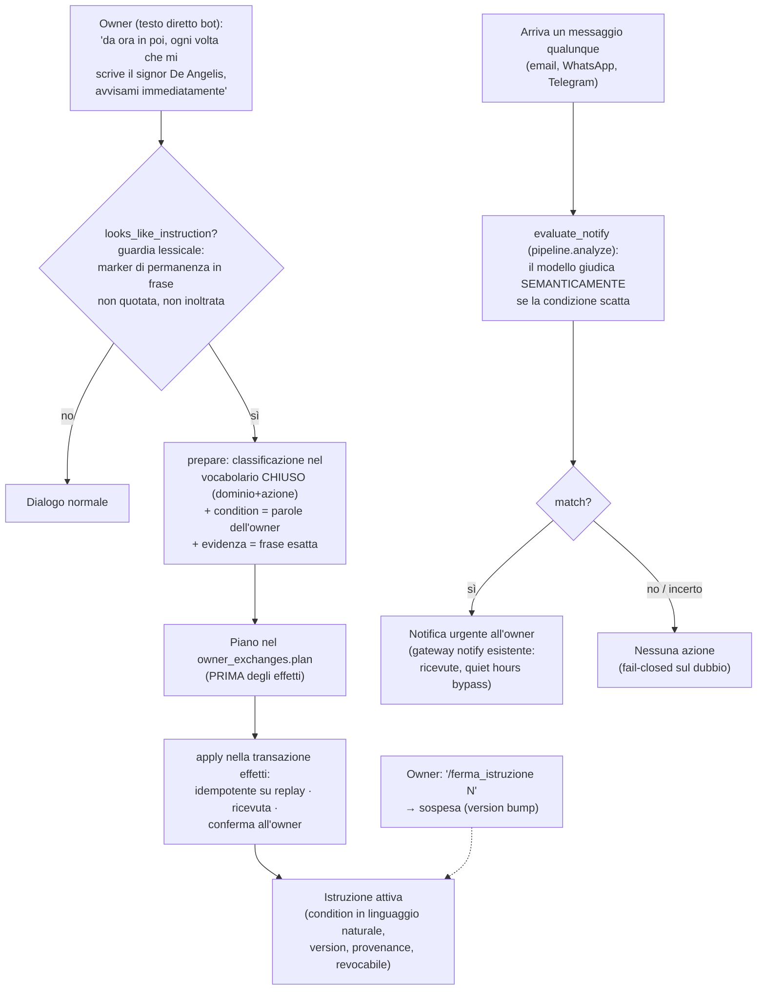

**I due domini del vocabolario chiuso**:

| Dominio | Azioni | Come scatta |
|---|---|---|
| `notify_on` | `notify_owner` | **Semantica per messaggio**: `evaluate_notify` in `pipeline.analyze` giudica la condizione (parole dell'owner) su ogni messaggio in arrivo; match ⇒ notifica urgente |
| `invoice_folder` | `route_by_sender_vat`, `route_by_sender_name` | **Deterministica all'archiviazione**: `invoices.save_invoice` consulta `invoice_folder(sender)` (P.IVA o nome del mittente, slug difensivo, fallback legacy) |

| | |
|---|---|
| **Input** | Testo diretto owner con marker di permanenza ('da ora in poi', 'sempre', 'ogni volta'…) |
| **Output** | Istruzione attiva (condizione = parole dell'owner, azione allowlistata, provenance, ricevuta); conferma all'owner; per ogni messaggio in arrivo: valutazione semantica → notifica urgente se la condizione scatta |
| **Guardie** | Azione = vocabolario CHIUSO server-declared (il modello può solo scegliere, mai inventare); condizione = stringa bounded, DATA mai autorità; evidenza = frase esatta non quotata; testo nativo verificato; apply idempotente; ID forged droppati dalla valutazione |
| **Invarianti** | Solo testo owner vivo/diretto/non inoltrato può creare istruzioni; il contenuto dei messaggi in arrivo non può mai creare/modificare/revocare condizioni (è untrusted data per il valutatore); il dubbio non matcha (fail-closed); la notifica passa dal gateway esistente con ricevute e quiet hours; revocabile con ricevuta |

---

## 8. Gateway email — i tre gesti dell'owner

L'invio email è l'effetto più pericoloso: richiede **tre gesti distinti dell'owner**, con la proposta sigillata e il dispatch esplicito separati nel tempo.

```mermaid
sequenceDiagram
    autonumber
    participant O as Owner
    participant D as Dashboard (CSRF + sessione)
    participant EX as execution.py
    participant DB as PostgreSQL
    participant W as Worker execute_approved
    participant S as SMTP

    rect rgb(230,240,255)
        Note over O,DB: Gesto 1 — proposta
        O->>D: compone email (destinatario, testo, allegati)
        D->>EX: request_email
        EX->>DB: INSERT proposta sigillata (hash testo + allegati + destinatario)
        EX-->>D: proposta in attesa (nessun job, nessun invio)
    end

    rect rgb(230,255,230)
        Note over O,DB: Gesto 2 — approvazione
        O->>D: approva (ricevuta; chiave solo nel DOM)
        D->>DB: ricevuta di approvazione owner
    end

    rect rgb(255,245,230)
        Note over O,DB: Gesto 3 — dispatch esplicito
        O->>D: "Invia ora"
        D->>EX: dispatch_email (richiede la chiave della ricevuta di approvazione)
        EX->>DB: INSERT dispatch + job (solo se SECRETARY_MODE = active)
    end

    W->>DB: claim job → grant recheck → COMMIT attempt (PRIMA di SMTP)
    W->>DB: documenti ricaricati + hash verificati nella transazione attempt
    W->>S: invio MIME (byte in memoria, mai percorsi file)
    S-->>W: esito
    W->>DB: ricevuta: accepted / failed / uncertain
    Note over W: uncertain → MAI rinviato alla cieca
```

| | |
|---|---|
| **Input** | Bozza owner dalla dashboard; approvazione; dispatch esplicito |
| **Output** | Proposta sigillata; dispatch; email inviata; ricevute complete |
| **Guardie** | CSRF/origin/sessione dashboard; `SECRETARY_MODE=active` (`quiet_hours.sends_allowed`); grant recheck nel worker; hash allegati verificati |
| **Invarianti** | Tre gesti distinti e non aggirabili; attempt committato prima dell'SMTP; gli allegati sono ricostruiti da byte verificati in memoria; un invio "uncertain" non viene mai ritentato automaticamente |

---

## 9. La macchina a stati delle ricevute

Ogni effetto esterno lascia una traccia immutabile con transizioni a senso unico.

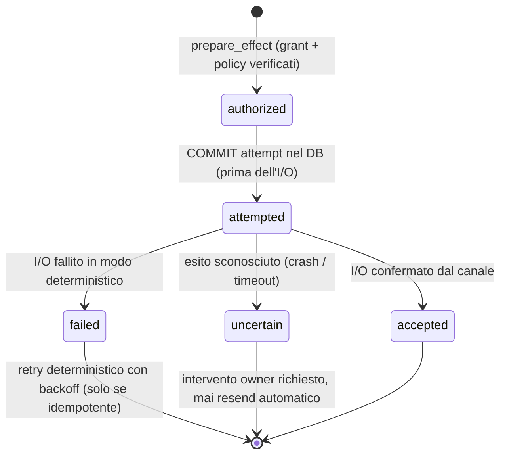

**Perché conta**: "accepted ≠ delivered" — la ricevuta dice cosa l'agente *sa*, non cosa *spera*. Un effetto `uncertain` (crash tra attempt e I/O) resta visibile e richiede una decisione dell'owner: il sistema non indovina.

---

## 10. Riconciliazione task

I task vivono o muoiono per **evidenza quotata**: il modello può proporre cambi solo citando testualmente la fonte, e l'auto-applicazione ha condizioni strettissime.

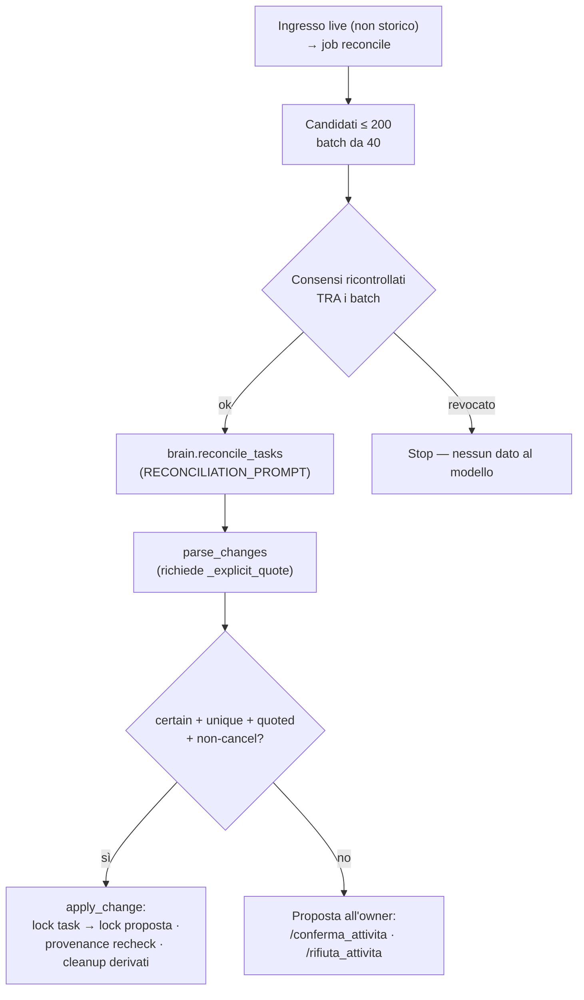

| | |
|---|---|
| **Input** | Job `reconcile` da ingresso live |
| **Output** | Cambi task auto-applicati (solo strettissimi) o proposte con comandi owner |
| **Guardie** | Candidati limitati; consensi ricontrollati tra i batch; citazione esplicita obbligatoria |
| **Invarianti** | Auto-apply solo per `certain + unique + quoted + non-cancel`; i task derivati (calendar/reminder) vengono ripuliti quando il task cambia; lo storico non riconcilia mai nulla |

---

## 11. Digest giornaliero

Il riassunto quotidiano è un effetto **sigillato dal sistema**, non testo libero del modello: ogni sorgente nativa passa per il filtro dei permessi.

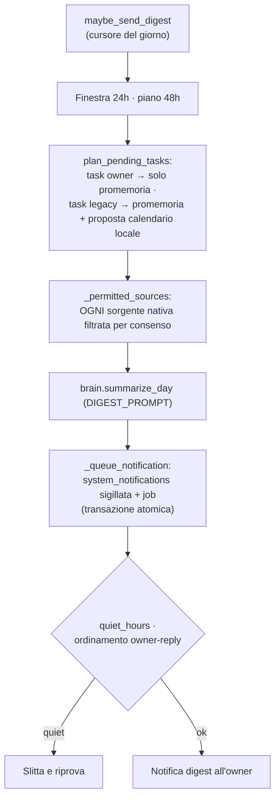

| | |
|---|---|
| **Input** | Cursore giornaliero del digest |
| **Output** | Notifica sigillata `system_notifications` + job di invio |
| **Guardie** | `_permitted_sources` su ogni sorgente; quiet hours; cursore idempotente |
| **Invarianti** | Notifica e job sigillati nella stessa transazione; il digest non può mai contenere dati di un canale revocato |

---

## 12. Guardie trasversali: budget AI, quiet hours, modalità

### Budget AI (`ai_budget.py`) — fail-closed, con scope

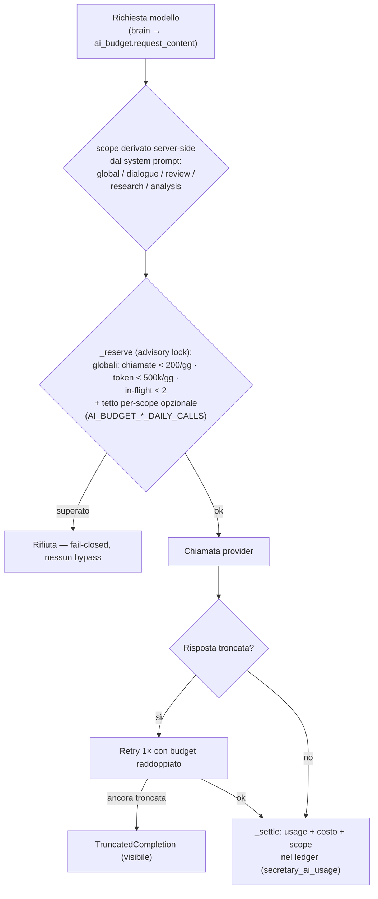

Il tetto per-scope **restringe mai supera** quello globale: un cap `dialogue=50`
limita le chiamate del dialogo ma non libera spazio sul tetto globale.

### Quiet hours + modalità (`quiet_hours.py`)

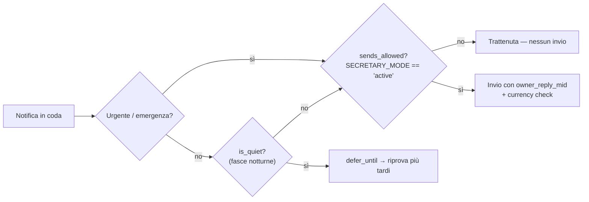

**Invarianti**: il budget fallisce **chiuso** (mai "un ultimo sforzo"); le emergenze bypassano le quiet hours ma mai la modalità; `SECRETARY_MODE` è l'interruttore generale di tutti gli invii in uscita.

---

## 13. Esempio end-to-end

Una pratica che nasce, viene osservata, revisionata e notificata — il ciclo completo dell'agente.

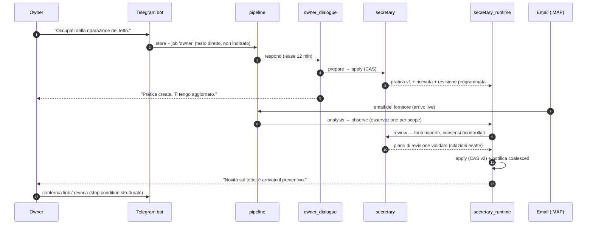

**Fil rouge dell'esempio**: a ogni passo, l'autorità viene dalla provenance nativa (il testo diretto dell'owner, l'email reale del fornitore), mai dall'output del modello; ogni effetto lascia ricevute immutabili; ogni consenso è ricontrollato al confine, non fidato a memoria.

---

*Documento generato il 2026-10-18 dopo un giro completo di sorgenti e test (~78 file). Le fonti di verità restano i sorgenti: aggiornare questo file quando l'architettura cambia.*
