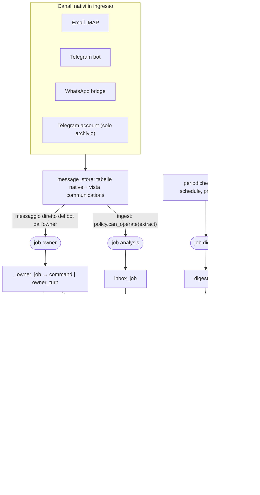
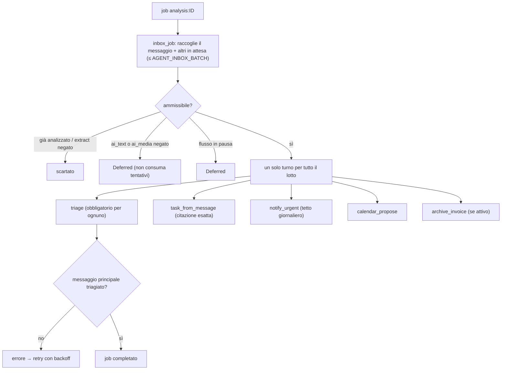
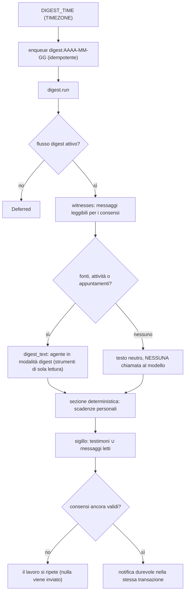
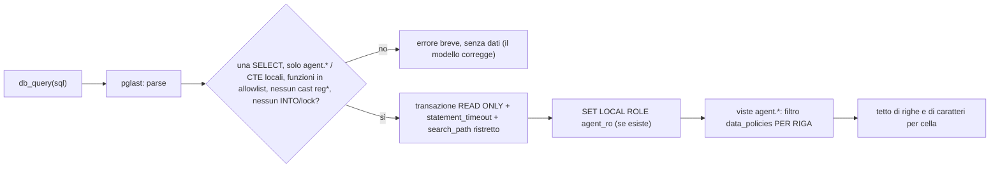
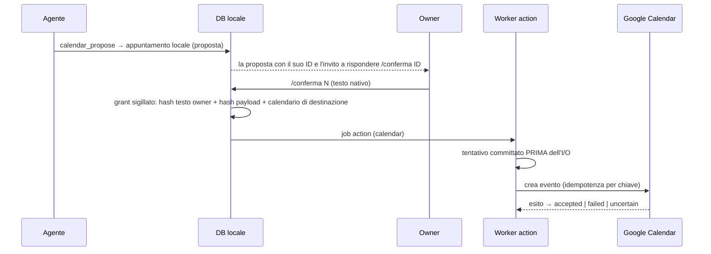
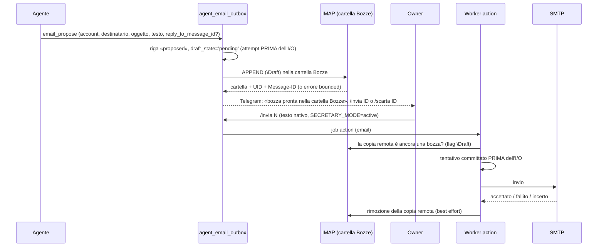
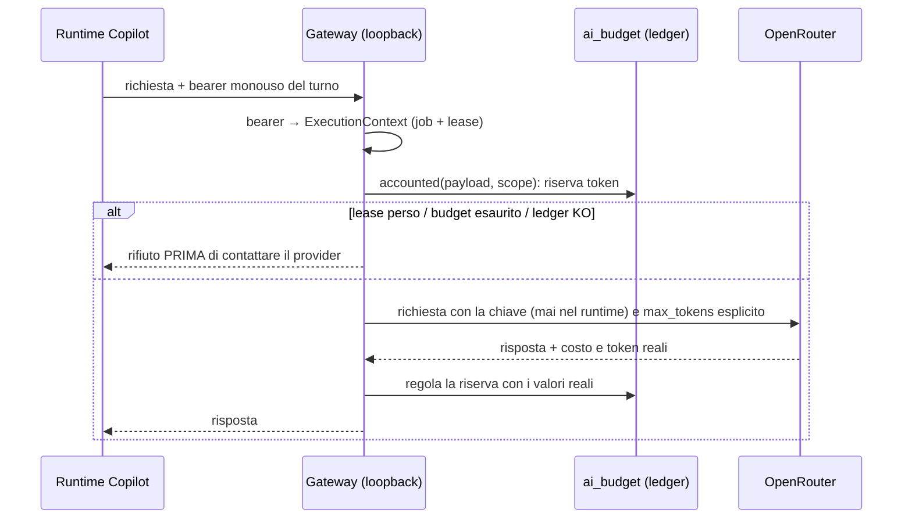
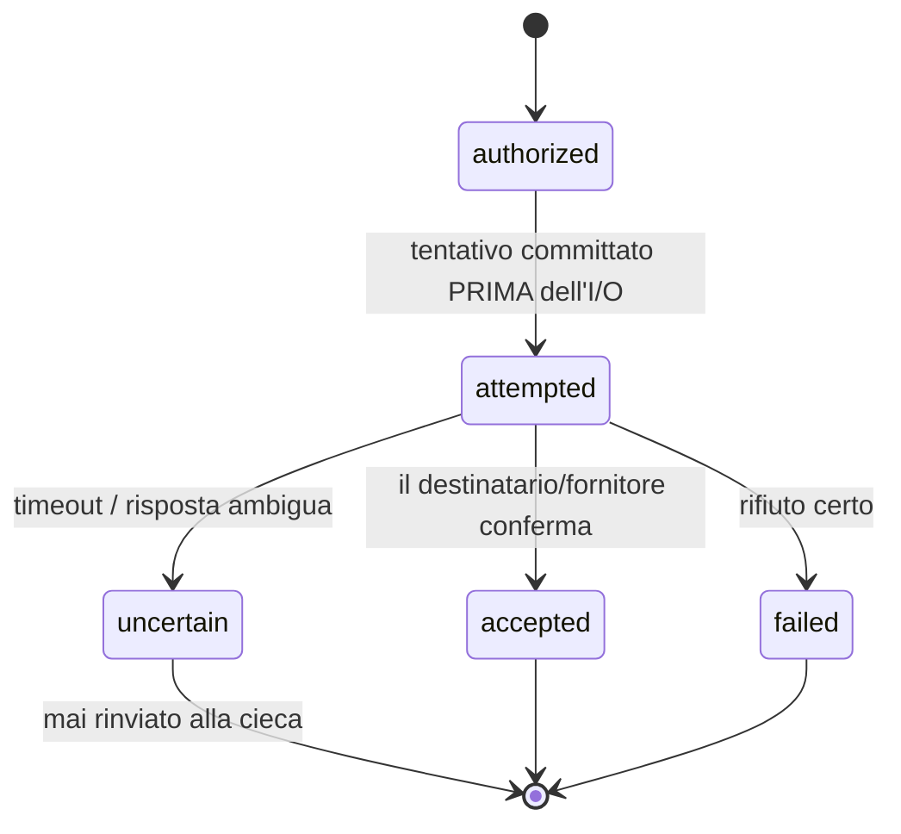

# AGENT_FLOWS.md — I flussi di p-secretary

**Complementa**: `AGENTS.md` (baseline e mappa dei moduli), `AGENTIC_CORE_PLAN.md`
(decisioni e stato di attuazione), `README.md` (visione d'insieme).

> Un solo agente, tre modi di lavorare. Ogni flusso qui sotto elenca **input**,
> **strumenti**, **guardie** e **invarianti**. Il principio cardine vale ovunque:
> **il modello non è mai autorità — la provenienza nativa verificata dal server lo è.**

## Indice

1. Panoramica: worker e coda durevole
2. Ingresso dei messaggi
3. Il turno dell'owner (dialogo)
4. Posta in arrivo (triage)
5. Riepilogo serale (digest)
6. SQL libero in sola lettura e consensi
7. Scritture: il journal degli effetti
8. Calendar: proposta → `/conferma`
9. Email in uscita: bozza → `/invia`
10. Gateway LLM e budget
11. Ricevute e stati degli effetti
12. Guardie trasversali
13. Esempio end-to-end

---

## 1. Panoramica: worker e coda durevole

Non c'è un loop monolitico: ogni lavoro è un **job** nella coda PostgreSQL `work_jobs`
(`SKIP LOCKED`, lease 15 min, heartbeat 30 s, deadline 1 h, backoff 15 s → 1 h, massimo
8 tentativi). `main()` avvia sei worker, uno per tipo di job:

| Worker (`kind`) | Handler | Cosa fa |
|---|---|---|
| `analysis` | `turns.inbox_job` | triage con l'agente dei messaggi in arrivo (a lotti) |
| `owner` | `main._owner_job` | comando slash deterministico **oppure** turno dell'agente |
| `digest` | `digest.run` | riepilogo serale `digest:AAAA-MM-GG` |
| `action` | `pipeline.action` | **unico punto con effetti esterni**: notifiche, Calendar, fatture, email |
| `media` | `media_archive.process` | trascrizione di vocali e immagini (con consenso media) |
| `knowledge` | `knowledge.index_message` | indice lessicale del testo degli allegati |



## 2. Ingresso dei messaggi

`pipeline.ingest` salva il messaggio nelle tabelle native (identità verificate in
ingresso: UIDVALIDITY per le email, metadata di inoltro per Telegram, version-ACK per
WhatsApp) e, **nella stessa transazione**, accoda **un solo** job `analysis:{id}` se
`policy.can_operate(..., 'extract')` lo consente. Lo storico importato (`historical`)
è archivio e contesto read-only: non genera mai job operativi.

Il bot accetta solo la chat privata dell'owner configurato; **ogni** suo input
diretto diventa un job `owner:{id}` (con ordine rispettato: una risposta alla
volta): testo, vocale, immagine o documento. Nessun input diretto viene ignorato.
Ogni messaggio dell'owner porta con sé la provenienza (`content_origin`,
`is_forwarded`) che il server rivaluta; il modello non la vede come argomento.

L'autorità è separata in due livelli:

| Effetto | Origini ammesse |
|---|---|
| `owner_dialogue` (rispondere, leggere) | `direct_text`, `direct_audio`, `attachment` |
| `owner_command` e ogni scrittura (`task_apply`, `memory_write`, `email_send`, …) | solo `direct_text` |

Quindi un vocale o una foto ricevono sempre una risposta, ma non possono mai
autorizzare una modifica: in quel caso l'agente risponde e chiede di scriverla.

## 3. Il turno dell'owner (dialogo)

```mermaid
sequenceDiagram
    autonumber
    participant O as Owner (Telegram)
    participant W as Worker owner
    participant C as owner.command
    participant T as turns.owner_turn
    participant R as Runtime + gateway
    participant K as toolkit
    participant A as Worker action
    O->>W: messaggio diretto (job owner:ID)
    W->>W: owner.authorize (testo nativo, vivo, non inoltrato)
    alt testo = comando slash e nessun allegato
        W->>C: /task /fatto /conferma /invia ...
        C-->>A: risposta deterministica (nessun modello)
    else richiesta libera
        W->>T: owner_turn(mid)
        T->>T: owner.begin (scambio idempotente, ordine rispettato)
        T->>T: owner.authorize(ai=True) → consenso ai_text/ai_media
        T->>R: prompt + conversazione recente
        Note over T: presenza: «sta scrivendo» ogni 4 s; dopo 8 s un messaggio di stato col passo corrente
        loop fino a AGENT_MAX_TOOL_CALLS
            R->>K: strumento (db_query, mail_search, task_change, ...)
            K->>K: lease + audit (+ journal.once se scrittura)
            K-->>R: risultato JSON
        end
        R-->>T: testo finale
        T->>T: presenza chiusa (messaggio di stato cancellato)
        T->>T: owner.complete: risposta + ricevute, stessa transazione
        T-->>A: owner-reply:ID:n
    end
    A->>O: messaggio Telegram
```

Punti da ricordare:

- **Sessione effimera**: il contesto si ricostruisce a ogni turno (ultimi scambi chiusi,
  risposte dell'assistente solo se più recenti di `AGENT_HISTORY_RESPONSE_MINUTES`);
  la sessione del runtime viene cancellata a fine turno.
- **Scritture sul conto dell'owner** (`task_change`, `tasks_close_bulk`, `note_save`,
  `note_forget`): `_require_owner` rivaluta l'autorità a ogni chiamata, e l'`evidence`
  deve essere una frase **esattamente contenuta** nel messaggio archiviato.
- **Ripresa dopo crash**: stessa `turn_key` (`owner:ID`) → `journal.executed` rimette nel
  prompt gli effetti già committati, e `journal.once` non ne ripete nessuno.
- **Richiesta identica**: entro `REUSE_MINUTES` una seconda copia dello stesso testo non
  innesca un secondo ciclo AI (riusa la risposta o si rimanda).
- **Feedback in chat** (`agent/presence.py`): mentre il turno è in corso il bot mostra
  «sta scrivendo» (rinnovato ogni 4 s). Se il turno dura più di 8 s compare un messaggio
  di stato silenzioso con il passo corrente (etichette fisse per strumento, nessun
  contenuto), aggiornato ogni 20 s o al cambio di passo e cancellato prima della
  risposta. È best effort: un errore di Telegram non fa fallire il turno.
- Comandi: `/start /stop /appuntamenti /note /regole /fatture /task /attivita /fatto
  /conferma /annulla /invia /scarta`, tutti deterministici.
- Strumenti del turno owner: `db_schema`, `db_query`, `read_message`, `attachment_text`,
  `fs_list/find/read/write/mkdir`, `mail_accounts/search/read`, `web_search`,
  `task_change`, `tasks_close_bulk`, `note_save`, `note_forget`, `calendar_propose`,
  `email_propose`.

## 4. Posta in arrivo (triage)



- Strumenti: lettura (`db_schema`, `db_query`, `read_message`, `attachment_text`) più
  `triage`, `task_from_message`, `notify_urgent`, `calendar_propose`, `archive_invoice`.
  **Nessun** `task_change`, `note_*`, file system, posta live né web: il contenuto di
  terzi non può modificare ciò che l'owner ha già deciso.
- `_in_batch` ammette solo messaggi del lotto corrente e ricontrolla `ai_text`.
- `task_from_message` richiede una citazione copiata esattamente dal messaggio e non
  funziona su messaggi inviati dall'owner (`direction='out'`); un'attività per messaggio.
- `notify_urgent` conta gli avvisi del giorno con **advisory lock transazionale**: due
  chiamate parallele dello stesso turno non possono superare `AGENT_NOTIFY_MAX_PER_DAY`.
  Oltre il tetto la segnalazione resta nel riepilogo serale. Il testo ha i link neutralizzati.
- Il prompt contiene un estratto del corpo (1500 caratteri); per il resto serve
  `read_message`, così il modello sceglie quanto leggere.

## 5. Riepilogo serale (digest)



Il recap copre le ultime 24 ore, il piano le successive 48. `digest_text` usa il budget
dello scope `agent_inbox`. Il sigillo impedisce che un consenso revocato **durante** la
generazione lasci passare testo derivato da dati ora negati.

## 6. SQL libero in sola lettura e consensi



- Le viste appartengono al ruolo applicativo; `agent_ro` ha `SELECT` **solo** su di esse
  (creato dall'app all'avvio se può, altrimenti dal DBA: `deploy/sql/agent_ro.sql`). Senza il ruolo resta la barriera AST + READ ONLY,
  e l'app lo segnala.
- Consensi per canale e tipo (`ai_text`, `ai_media`, `ai_history`) **default negato**,
  rivalutati a ogni query: revocarne uno nasconde subito i dati.
- Le viste non espongono token, grant, ricevute, credenziali né i byte degli allegati.
  `messages.media_missing` dice se un allegato multimediale non è stato persistito.
- Letture dal vivo (`mail_*`): IMAP in sola lettura, consenso `email/ai_text` a ogni chiamata.
- Il testo restituito al modello è **dato non fidato**: il prompt lo dice, ma la
  garanzia sono i permessi degli strumenti (un'email ostile non può scrivere).

## 7. Scritture: il journal degli effetti

Ogni scrittura è `_journaled → journal.once(conn, turn_key, tool, args, apply)`:

1. `INSERT INTO agent_effects(turn_key, effect_key, tool) … ON CONFLICT DO NOTHING`
2. se la riga esiste già, si restituisce il risultato committato (`replayed=true`);
3. altrimenti `apply(conn)` e `UPDATE … SET result` **nella stessa transazione**.

Un crash a metà non lascia metà effetto; un modello che ripete la chiamata, o un job che
riparte, non duplica nulla. `agent_tool_calls` registra solo metadati limitati (nome,
esito, durata): **mai** prompt né risposte.

## 8. Calendar: proposta → `/conferma`



L'agente **non può** scrivere su Calendar: crea soltanto la proposta. Il grant lega il
payload esatto e la destinazione; un replay non lo rinnova. Annullare un evento remoto
richiede un nuovo gesto esplicito (`/annulla N`): chiudere un'attività non basta.

## 9. Email in uscita: bozza nella casella → `/invia`



La bozza è **vera**: il proprietario la vede e la modifica dal suo mail client. Il thread
(`In-Reply-To`/`References`) è ricavato dal server dal messaggio archiviato indicato con
`reply_to_message_id`, mai dal modello; il destinatario deve essere il mittente di quel
messaggio. Se il proprietario ha già inviato o cancellato la bozza dal client, il flag
`\Draft` non c'è più e l'invio si ferma (fallimento permanente) invece di duplicare.
`/scarta` rimuove la copia remota solo finché è ancora una bozza.

Vincoli: un solo destinatario, indirizzo nudo (niente nome visualizzato), nessun
allegato né intestazione arbitraria, account dalla configurazione. `/invia` è rifiutato se
`SECRETARY_MODE='observe'`. Un esito incerto non viene mai rinviato alla cieca.

## 10. Gateway LLM e budget



Scope del ledger derivato dal server: `agent_owner` (turni dell'owner), `agent_inbox`
(triage e digest), più i flussi diretti (media). Tetti per scope con
`AI_BUDGET_AGENT_OWNER_DAILY_CALLS` / `AI_BUDGET_AGENT_INBOX_DAILY_CALLS`, oltre ai
tetti globali `AI_BUDGET_*`. Il budget esaurito **differisce** il job (non consuma
tentativi) invece di fallire.

## 11. Ricevute e stati degli effetti



«Accettato» non significa «consegnato». Un `uncertain` richiede riconciliazione manuale
dell'owner; il retry automatico vale solo per errori **prima** dell'I/O.

## 12. Guardie trasversali

- **Lease**: `jobs.assert_current` prima di ogni effetto e a ogni strumento.
- **Niente fascia silenziosa**: l'unica notifica autonoma è `notify_urgent` (vere emergenze, tetto
  giornaliero); il resto aspetta il riepilogo all'ora scelta. Per questo `QUIET_HOURS_*` è stato rimosso.
- **Modalità** `SECRETARY_MODE`: `observe` (default) = solo proposte; `active` consente
  l'invio delle bozze **approvate** con `/invia`.
- **Capabilities** (`secretary/core/capabilities.py`): fatture/ZIP disattivati per default.
- **Privacy**: `privacy.erase_message` cancella il messaggio e i dati derivati (anche
  `agent_*` collegati) con ricevuta; l'erase nei backup resta a carico dell'operatore.
- **Retention**: `workflows/retention.py` (passata giornaliera dal loop principale) pota la storia scaduta
  con i suoi file, i job conclusi (solo il payload), l'outbox email terminale e il ledger AI; `pipeline.schedule`
  pota ogni giorno l'audit delle policy e il journal dell'agente. Dettagli in [OPERATIONS.md](OPERATIONS.md#retention).

## 13. Esempio end-to-end

Owner: *«Cerca nelle mail il preventivo di Rossi, riassumilo in workspace/rossi.md e
avvisa il commercialista»*.

1. `owner:ID` → `authorize` (testo nativo diretto) → `owner_turn`.
2. L'agente chiama `mail_search` (IMAP, sola lettura) e `mail_read`; verifica con
   `db_query` se esiste già una nota; scrive `fs_write workspace/rossi.md`.
3. Per «avvisa il commercialista» chiama `email_propose` → bozza `#7` in stato `proposed`.
4. Risposta all'owner: riassunto + invito a decidere sulla bozza #7 (`/invia 7` o `/scarta 7`) +
   ricevute delle scritture, accodata in `owner-reply:ID:0` insieme al salvataggio dello scambio.
5. Owner: `/invia 7` → comando deterministico → `pipeline.action` (email): tentativo
   committato, SMTP, ricevuta `accepted`. Se `SECRETARY_MODE=observe`: rifiutato.
6. Il file compare nella pagina «Archivio e file» → `workspace/rossi.md`.
